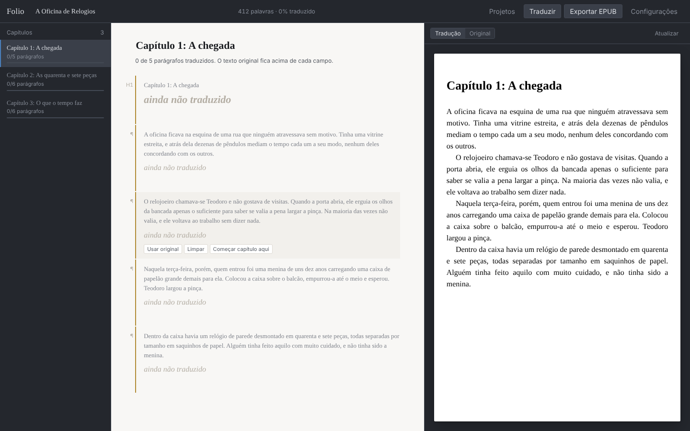

# Interlinear

[](https://github.com/LucasAzevedoCosta/interlinear/actions/workflows/ci.yml)

Converte PDF em EPUB, deixa você editar o resultado com prévia ao vivo e traduz
o livro inteiro usando o modelo de IA que você escolher — na nuvem ou rodando
na sua própria máquina.

Roda inteiramente no seu computador. Nenhum texto sai dele, a não ser para o
provedor de IA que você configurar.



## Por que existe

Ferramentas de conversão de PDF para EPUB resolvem metade do problema: produzem
um arquivo, mas a estrutura sai torta e não há onde arrumar. Tradutores
automáticos resolvem a outra metade, mas tratam um livro como se fosse um texto
grande, e o resultado perde consistência de nomes e termos ao longo dos
capítulos.

O Interlinear junta as duas coisas num lugar só, com um princípio: **o original nunca
é descartado**. Cada parágrafo guarda o texto de origem ao lado da tradução, e
você revisa os dois lado a lado. A prévia usa o mesmo gerador de XHTML da
exportação, então o que aparece na tela é exatamente o que vai para o arquivo.

## O que ele faz

- **Importa** PDFs com texto nativo, PDFs escaneados (OCR com Tesseract) e
  EPUBs existentes
- **Reconstrói** capítulos, títulos e parágrafos a partir das pistas
  tipográficas do PDF (tamanho de fonte, recuo, espaçamento), descartando
  cabeçalhos correntes e números de página
- **Separa conversão de tradução.** Na etapa de conversão você corrige o
  texto que veio do arquivo, o tipo de cada bloco e onde começam os capítulos,
  e exporta o EPUB sem traduzir nada. Na de tradução, cada original ganha o
  campo da tradução; mudar um original depois marca a tradução dele como
  desatualizada, e o próximo **Traduzir** refaz só esses
- **Edita** parágrafo a parágrafo, com salvamento automático
- **Mostra a prévia** de cada capítulo como ele vai aparecer no leitor
- **Traduz** com OpenAI, Anthropic, Google Gemini, qualquer endpoint compatível
  (OpenRouter, DeepSeek, Groq), ou modelos locais via LM Studio e Ollama
- **Exporta** EPUB 3 válido, com a tradução ou com o original

## Documentação

| Assunto | Arquivo |
| ------- | ------- |
| Formato EPUB, aparelhos compatíveis, ferramentas, IA local no Mac, decisões técnicas | [docs/guia.md](docs/guia.md) |
| Por que converter PDF é difícil, limitações, papel do preview, custos de IA | [docs/conversao.md](docs/conversao.md) |
| Licenças das dependências e a armadilha do AGPL | [docs/licencas.md](docs/licencas.md) |

Abrindo o projeto pela primeira vez, comece pelo [guia](docs/guia.md).

## Instalação

Requer Python 3.11 ou mais recente.

```bash
git clone <url-do-seu-repositorio> interlinear
cd interlinear

python3 -m venv .venv
source .venv/bin/activate        # no Windows: .venv\Scripts\activate

pip install -r requirements.txt
```

Para importar PDFs escaneados, instale também o
[Tesseract](https://tesseract-ocr.github.io/) com os idiomas dos seus livros
(`brew install tesseract tesseract-lang` no Mac,
`apt install tesseract-ocr tesseract-ocr-por` no Debian/Ubuntu). Sem ele, o
resto funciona e o app avisa ao receber um PDF sem texto. A imagem Docker já
traz o Tesseract com português e inglês.

## Como usar

```bash
cd backend
python -m uvicorn app.main:app --port 8000
```

Abra `http://127.0.0.1:8000`. O servidor escuta só em `127.0.0.1`, ou seja,
nada responde na rede local.

1. Escolha a caixa: **Converter** (PDF em EPUB, sem tradução) ou
   **Traduzir** (um EPUB, ou um PDF que é convertido antes). Confira as
   opções (título, onde começam os capítulos, OCR e, para traduzir, os
   idiomas e o provedor) e acompanhe o progresso. No fim, um resumo mostra o
   que foi encontrado e o que vale conferir. Cada caixa abre o livro na sua
   etapa, mas as duas continuam disponíveis em qualquer livro
2. Na etapa **Conversão**, corrija o que a extração errou, conferindo na
   prévia à direita. Para só converter, pare aqui e use **Exportar EPUB →
   Original**
3. Em **Configurações**, adicione um provedor de IA e cole sua chave
4. Na etapa **Tradução**, clique em **Traduzir** e revise os parágrafos. Cada
   livro guarda os seus idiomas e o seu provedor (troque em **Trocar**, na
   nota do capítulo); um livro vindo da conversão pergunta isso no primeiro
   **Traduzir**
5. **Exportar EPUB → Traduzido**

### Escolhendo um modelo

Para tradução literária, o custo é dominado pelo volume: um romance de 100 mil
palavras gasta na casa de 250 a 400 mil tokens de entrada e outro tanto de
saída. Compensa testar um capítulo em dois ou três modelos e comparar antes de
soltar o livro inteiro.

Modelos locais (LM Studio, Ollama) não têm custo por token e mantêm o texto na
sua máquina, ao preço de mais tempo de processamento. Num Mac com Apple
Silicon, um modelo de 12B a 14B em 4 bits é um bom ponto de partida.

### Glossário

Em **Configurações → Glossário**, um par por linha:

```
Shire = Condado
Baggins = Bolseiro
```

O glossário é injetado em todo lote enviado ao modelo, que é o que mantém nomes
e termos iguais do começo ao fim do livro.

## Rodando com Docker

```bash
docker compose up -d --build
```

Abra `http://127.0.0.1:8000`. A porta é publicada só em `127.0.0.1`, como na
execução direta.

- **Dados:** projetos e preferências ficam no volume `interlinear-data`
  (montado em `/data`), e sobrevivem a rebuilds. `docker compose down -v`
  apaga tudo.
- **Chaves:** crie um arquivo `.env` ao lado do `compose.yaml` com
  `INTERLINEAR_OPENAI_KEY=...` e afins. O `.env` está no `.gitignore`.
- **IA local:** o container alcança Ollama e LM Studio do seu computador por
  `host.docker.internal`, já configurado. O LM Studio precisa estar servindo
  na rede (opção *Serve on Local Network*), não só em `localhost`.
- **Logs:** `docker compose logs -f`

## Variáveis de ambiente

| Variável                    | Para quê                                          |
| --------------------------- | ------------------------------------------------- |
| `INTERLINEAR_DATA_DIR`      | Onde ficam projetos e preferências                |
| `INTERLINEAR_HOST`          | Endereço de escuta (padrão `127.0.0.1`)           |
| `INTERLINEAR_PORT`          | Porta (padrão `8000`)                             |
| `INTERLINEAR_ALLOWED_HOSTS` | Nomes extras aceitos no `Host`, separados por vírgula (`*` desliga a checagem) |
| `INTERLINEAR_OPENAI_KEY`    | Chave da OpenAI, tem prioridade sobre a salva     |
| `INTERLINEAR_ANTHROPIC_KEY` | Idem, Anthropic                                   |
| `INTERLINEAR_GOOGLE_KEY`    | Idem, Google                                      |
| `INTERLINEAR_COMPAT_KEY`    | Idem, endpoint compatível (OpenRouter etc.)       |
| `INTERLINEAR_OLLAMA_URL`    | Endereço padrão do Ollama                         |
| `INTERLINEAR_LMSTUDIO_URL`  | Endereço padrão do LM Studio                      |
| `INTERLINEAR_LOG_LEVEL`     | `DEBUG` para ver o que o extrator decidiu         |
| `INTERLINEAR_OCR_LANGS`     | Idiomas do OCR (padrão `por+eng`; só os instalados valem) |
| `INTERLINEAR_TESSERACT`     | Caminho do Tesseract, se não estiver no `PATH`    |

Usar as variáveis de ambiente evita gravar chave nenhuma em disco.

## Testes

```bash
pip install -r requirements-dev.txt
pytest
```

A suíte gera um PDF de teste com as armadilhas que aparecem em livros reais —
cabeçalho corrente, numeração, parágrafo que atravessa a quebra de página,
diálogo com travessão — e confere o caminho completo até o EPUB e de volta.

## Como está organizado

```
backend/app/
  core/            nada aqui sabe que existe uma web ou uma IA
    blocks.py      estrutura de dados comum a tudo
    importer.py    arquivo enviado → documento, com progresso e resumo
    pdf_extract.py PDF → blocos, via pistas tipográficas
    ocr.py         páginas escaneadas → linhas, via Tesseract
    structure.py   blocos → capítulos
    epub_write.py  capítulos → EPUB 3
    epub_read.py   EPUB → blocos
    storage.py     projetos em disco, gravação atômica
  ai/
    base.py        interface comum, retentativa com espera exponencial
    providers.py   OpenAI, Anthropic, Google, Ollama, LM Studio
    translator.py  lotes, glossário, contexto, verificação de formato
  jobs.py          tarefas em segundo plano: importação e tradução
  routes/          HTTP
frontend/          JavaScript puro, sem build
```

A regra que mantém isso navegável: `core/` não importa nada de `ai/` nem de
`routes/`. Dá para usar o conversor como biblioteca, sem subir servidor:

```python
from app.core.pdf_extract import extract_blocks
from app.core.structure import split_into_chapters
from app.core.epub_write import write_epub
from app.core.blocks import Document

blocks, title = extract_blocks("livro.pdf", source_name="livro.pdf")
doc = Document(title=title)
doc.chapters = split_into_chapters(blocks)
write_epub(doc, "livro.epub")
```

## Limitações conhecidas

- **PDFs escaneados** passam por OCR, que leva cerca de 1 segundo por página
  por núcleo (um livro de 300 páginas, perto de 1 minuto num computador de 4
  a 8 núcleos) e não detecta itálico nem negrito. Num PDF misto, só as
  páginas escaneadas passam pelo OCR.
- **Duas colunas** são lidas uma depois da outra. Três colunas ou mais, e
  colunas de larguras muito diferentes, ainda saem fora de ordem.
- **Imagens de PDF só em JPEG e bitmap RGB/cinza.** CMYK, paleta, JPEG 2000 e
  JBIG2 são ignorados (as imagens de EPUB são todas preservadas).
- **Itálico e negrito do PDF dependem do nome da fonte** ("Times-Italic",
  "MinionPro-It"). Uma fonte itálica com nome genérico passa como texto normal.
- **Notas de rodapé** são reconhecidas pelo corpo menor no pé da página e
  por um marcador ("1", "*", "†"). Notas sem marcador, ou no pé de uma só
  coluna em página de duas colunas, ainda entram como parágrafos.
- **Tabelas** são reconhecidas quando cada linha tem células alinhadas em
  colunas. Célula com texto em mais de uma linha, e tabela sem vão entre as
  colunas, ainda saem erradas; dá para corrigir o texto no editor.

A lista completa, com a explicação de por que a conversão de PDF é um problema
inverso, como o preview compensa, onde um modelo de IA ajudaria e quanto isso
custa, está em [docs/conversao.md](docs/conversao.md).

Nada disso se aplica quando a origem é um EPUB: ali a estrutura já vem pronta
no arquivo.

## Licença

MIT, veja [LICENSE](LICENSE). Todas as dependências têm licença permissiva, o
que torna essa escolha possível — detalhes e armadilhas em
[docs/licencas.md](docs/licencas.md).

## Sobre direitos autorais das obras

Converter e traduzir um livro para uso pessoal é uma coisa; publicar ou
distribuir a tradução é outra, e depende de autorização de quem detém os
direitos. Esta ferramenta não verifica nada disso — a responsabilidade é de
quem usa.
