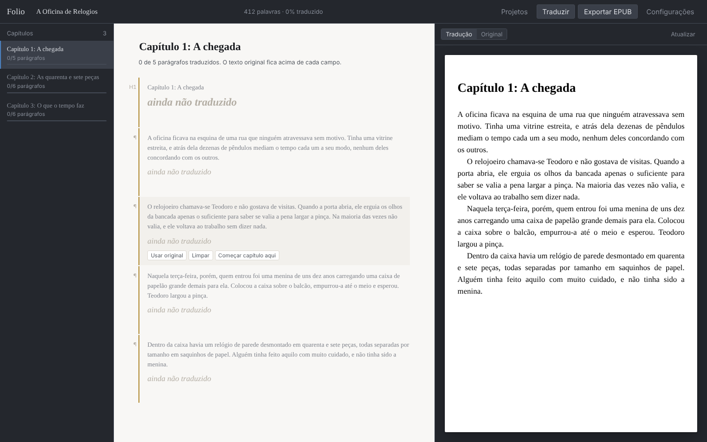

# Interlinear

[](https://github.com/LucasAzevedoCosta/interlinear/actions/workflows/ci.yml)

Converte PDF em EPUB, deixa você editar o resultado com prévia ao vivo e traduz
o livro inteiro usando o modelo de IA que você escolher — na nuvem ou rodando
na sua própria máquina.

Roda inteiramente no seu computador. Nenhum texto sai dele, a não ser para o
provedor de IA que você configurar.



## Por que existe

Ferramentas de conversão de PDF para EPUB resolvem metade do problema: produzem
um arquivo, mas a estrutura sai torta e não há onde arrumar. Tradutores
automáticos resolvem a outra metade, mas tratam um livro como se fosse um texto
grande, e o resultado perde consistência de nomes e termos ao longo dos
capítulos.

O Interlinear junta as duas coisas num lugar só, com um princípio: **o original nunca
é descartado**. Cada parágrafo guarda o texto de origem ao lado da tradução, e
você revisa os dois lado a lado. A prévia usa o mesmo gerador de XHTML da
exportação, então o que aparece na tela é exatamente o que vai para o arquivo.

## O que ele faz

- **Importa** PDFs com texto nativo, PDFs escaneados (OCR com Tesseract) e
  EPUBs existentes
- **Reconstrói** capítulos, títulos e parágrafos a partir das pistas
  tipográficas do PDF (tamanho de fonte, recuo, espaçamento), descartando
  cabeçalhos correntes e números de página
- **Separa conversão de tradução.** Na etapa de conversão você corrige o
  texto que veio do arquivo, o tipo de cada bloco e onde começam os capítulos,
  e exporta o EPUB sem traduzir nada. Na de tradução, cada original ganha o
  campo da tradução; mudar um original depois marca a tradução dele como
  desatualizada, e o próximo **Traduzir** refaz só esses
- **Aponta os trechos duvidosos** da conversão (parágrafo partido, cabeçalho
  que escapou, número de página) e, se você quiser, **revisa com IA**: o
  modelo sugere o que fazer com cada um, e você aceita ou deixa que ele aplique
  sozinho as correções de baixo risco, sempre com desfazer. Também compara a
  imagem da página do PDF com o texto, para achar o que sumiu na conversão
  ([docs/conversao.md](docs/conversao.md), seções 4 e 5)
- **Edita** parágrafo a parágrafo, com salvamento automático
- **Mostra a prévia** de cada capítulo como ele vai aparecer no leitor
- **Traduz** com OpenAI, Anthropic, Google Gemini, qualquer endpoint compatível
  (OpenRouter, DeepSeek, Groq), modelos locais via LM Studio e Ollama, ou,
  em modo experimental, com a sua assinatura do Claude, pelo Claude Code
  ([docs/provedores.md](docs/provedores.md))
- **Exporta** EPUB 3 válido, com a tradução ou com o original

## Documentação

| Assunto | Arquivo |
| ------- | ------- |
| Formato EPUB, aparelhos compatíveis, ferramentas, IA local no Mac, decisões técnicas | [docs/guia.md](docs/guia.md) |
| Por que converter PDF é difícil, limitações, papel do preview, custos de IA | [docs/conversao.md](docs/conversao.md) |
| Licenças das dependências e a armadilha do AGPL | [docs/licencas.md](docs/licencas.md) |
| Provedores de IA, inclusive o Claude pela assinatura (experimental) | [docs/provedores.md](docs/provedores.md) |
| Variáveis de ambiente, dados, IA local, rede, OCR em outros idiomas | [docs/configuracao.md](docs/configuracao.md) |
| Arquitetura e uso do conversor como biblioteca | [docs/guia.md](docs/guia.md#arquitetura) |
| Como sai uma versão | [docs/release.md](docs/release.md) |
| O que mudou em cada versão | [CHANGELOG.md](CHANGELOG.md) |

Abrindo o projeto pela primeira vez, comece pelo [guia](docs/guia.md).

## Instalação

Precisa só do Docker: [Docker Desktop](https://www.docker.com/products/docker-desktop/)
no Windows e no Mac, Docker Engine no Linux. O Interlinear roda inteiro dentro
do container, com o OCR já incluído; nada é instalado no seu computador.

Numa pasta vazia, baixe o `compose.yaml` e suba:

```bash
curl -fsSLO https://raw.githubusercontent.com/LucasAzevedoCosta/interlinear/main/compose.yaml
docker compose up -d
```

Abra `http://127.0.0.1:8000`. A porta é publicada só em `127.0.0.1`: nada
responde na rede local.

No Windows sem `curl`, salve o
[compose.yaml](https://raw.githubusercontent.com/LucasAzevedoCosta/interlinear/main/compose.yaml)
pelo navegador.

| Para | Comando |
| ---- | ------- |
| Ver os logs | `docker compose logs -f` |
| Parar | `docker compose down` |
| Atualizar | `docker compose pull && docker compose up -d` |
| Apagar tudo, inclusive os projetos | `docker compose down -v` |

- **Chaves de API:** cole na tela de Configurações, ou ponha num arquivo
  `.env` ao lado do `compose.yaml` (modelo em [.env.example](.env.example)).
- **Claude pela assinatura (experimental):** ponha
  `INTERLINEAR_IMAGE_TAG=claude` no `.env` e rode `docker compose up -d`. Essa
  imagem traz o Claude Code ([docs/provedores.md](docs/provedores.md)).
- **IA local:** o container já alcança o Ollama e o LM Studio do seu
  computador ([docs/configuracao.md](docs/configuracao.md#ia-local)).

### A partir do código

Para construir a imagem você mesmo (para modificar o código, veja o
[CONTRIBUTING.md](CONTRIBUTING.md)):

```bash
git clone https://github.com/LucasAzevedoCosta/interlinear.git
cd interlinear
docker compose up -d --build
```

O primeiro build leva alguns minutos. Com `INTERLINEAR_WITH_CLAUDE=1` no
`.env`, a imagem construída inclui o Claude Code.

## Como usar

1. Escolha a caixa: **Converter** (PDF em EPUB, sem tradução) ou
   **Traduzir** (um EPUB, ou um PDF que é convertido antes). Confira as
   opções (título, onde começam os capítulos, OCR e, para traduzir, os
   idiomas e o provedor) e acompanhe o progresso. No fim, um resumo mostra o
   que foi encontrado e o que vale conferir. Cada caixa abre o livro na sua
   etapa, mas as duas continuam disponíveis em qualquer livro
2. Na etapa **Conversão**, corrija o que a extração errou, conferindo na
   prévia à direita. Para só converter, pare aqui e use **Exportar EPUB →
   Original**
3. Em **Configurações**, adicione um provedor de IA e cole sua chave
4. Na etapa **Tradução**, clique em **Traduzir** e revise os parágrafos. Cada
   livro guarda os seus idiomas e o seu provedor (troque em **Trocar**, na
   nota do capítulo); um livro vindo da conversão pergunta isso no primeiro
   **Traduzir**
5. **Exportar EPUB → Traduzido**

### Escolhendo um modelo

Para tradução literária, o custo é dominado pelo volume: um romance de 100 mil
palavras gasta na casa de 250 a 400 mil tokens de entrada e outro tanto de
saída. Compensa testar um capítulo em dois ou três modelos e comparar antes de
soltar o livro inteiro.

O campo **Modelo** busca a lista no próprio serviço assim que há chave (ou
direto, nos locais), sem precisar salvar antes: os mais novos vêm primeiro,
com nome e data quando o serviço informa, e modelos que não traduzem
(embeddings, áudio, imagem) ficam de fora. Digite para filtrar; um nome fora
da lista também vale, se o serviço aceitar.

Modelos locais (LM Studio, Ollama) não têm custo por token e mantêm o texto na
sua máquina, ao preço de mais tempo de processamento. Num Mac com Apple
Silicon, um modelo de 12B a 14B em 4 bits é um bom ponto de partida.

### Glossário

Em **Configurações → Glossário**, um par por linha:

```
Shire = Condado
Baggins = Bolseiro
```

O glossário é injetado em todo lote enviado ao modelo, que é o que mantém nomes
e termos iguais do começo ao fim do livro.

## Contribuindo

Contribuições são bem-vindas: correções, suporte a mais layouts de PDF, novos
provedores de IA, traduções da interface. Antes de abrir um pull request, leia
o [CONTRIBUTING.md](CONTRIBUTING.md), que explica como preparar o ambiente, as
regras da arquitetura e o padrão dos commits. Para relatar uma falha de
segurança, siga o [SECURITY.md](SECURITY.md) em vez de abrir uma issue.

## Limitações conhecidas

- **PDFs escaneados** passam por OCR, que leva cerca de 1 segundo por página
  por núcleo (um livro de 300 páginas, perto de 1 minuto num computador de 4
  a 8 núcleos) e não detecta itálico nem negrito. Num PDF misto, só as
  páginas escaneadas passam pelo OCR.
- **Duas colunas** são lidas uma depois da outra. Três colunas ou mais, e
  colunas de larguras muito diferentes, ainda saem fora de ordem.
- **Imagens de PDF só em JPEG e bitmap RGB/cinza.** CMYK, paleta, JPEG 2000 e
  JBIG2 são ignorados (as imagens de EPUB são todas preservadas).
- **Itálico e negrito do PDF dependem do nome da fonte** ("Times-Italic",
  "MinionPro-It"). Uma fonte itálica com nome genérico passa como texto normal.
- **Notas de rodapé** são reconhecidas pelo corpo menor no pé da página e
  por um marcador ("1", "*", "†"). Notas sem marcador, ou no pé de uma só
  coluna em página de duas colunas, ainda entram como parágrafos.
- **Tabelas** são reconhecidas quando cada linha tem células alinhadas em
  colunas. Célula com texto em mais de uma linha, e tabela sem vão entre as
  colunas, ainda saem erradas; dá para corrigir o texto no editor.

A lista completa, com a explicação de por que a conversão de PDF é um problema
inverso, como o preview compensa, onde um modelo de IA ajudaria e quanto isso
custa, está em [docs/conversao.md](docs/conversao.md).

Nada disso se aplica quando a origem é um EPUB: ali a estrutura já vem pronta
no arquivo.

## Licença

MIT, veja [LICENSE](LICENSE). Todas as dependências têm licença permissiva, o
que torna essa escolha possível — detalhes e armadilhas em
[docs/licencas.md](docs/licencas.md).

## Sobre direitos autorais das obras

Converter e traduzir um livro para uso pessoal é uma coisa; publicar ou
distribuir a tradução é outra, e depende de autorização de quem detém os
direitos. Esta ferramenta não verifica nada disso — a responsabilidade é de
quem usa.
